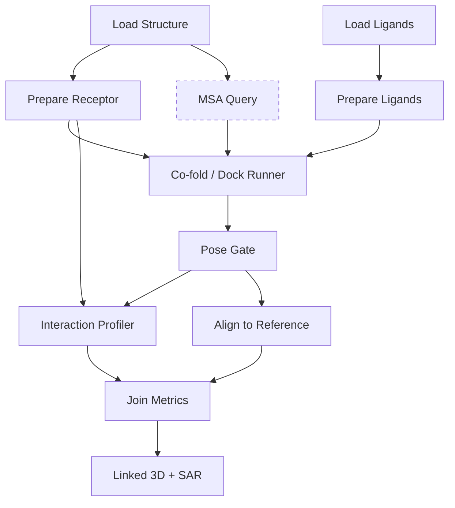

# Architecture (v0.1)

From the *v0.1 Engineering Plan* ([source](https://claude.ai/artifact/2GK7mU3HZBia5LzZGtZzZb)). Rust at the hub, Python/CUDA at the edges, modelled on Rerun.io.

## Crate layers

```mermaid
flowchart TB
  subgraph UI["UI: the only crates that see GPUI Kit"]
    app["app<br/>shell, docking"]
    uig["ui-graph<br/>node canvas"]
    uiv["ui-viewport<br/>ViewportBackend"]
    uip["ui-panels<br/>table, plot, SAR"]
  end
  subgraph ORCH["Orchestration: no GPUI, headless"]
    graph["graph<br/>DAG, scheduler, cache"]
    nodes["nodes<br/>the 11 v0.1 nodes"]
    jobs["jobs<br/>worker supervision"]
    recipe["recipe + cli<br/>TOML, replay"]
  end
  subgraph CORE["Domain core: no GPUI, no async"]
    mol["mol<br/>arena, PDB/mmCIF"]
    chem["chem<br/>RDKit FFI"]
    geom["geom<br/>KD-tree, gate"]
    render["render<br/>wgpu, WGSL"]
  end
  subgraph W["Workers: separate processes, never linked"]
    boltz["boltz2"]; vina["vina"]; mock["mock-cofold"]
  end
  UI --> ORCH --> CORE
  jobs -. "spawns, JSON over stdio" .-> W
```

**The rule CI enforces:** no crate below the UI band lists a GPUI crate. `mol`, `geom`, `graph`, `render` must build and test on a headless machine. The `cli` binary reaches only into the orchestration and domain bands, so a recipe replays with no window and no GPU compositor.

Allowed internal edges (as wired in each `Cargo.toml`):

| Crate | Depends on |
|---|---|
| mol | none |
| chem, geom, render | mol |
| graph | mol |
| jobs | none |
| nodes | mol, chem, geom, graph, jobs |
| recipe | graph |
| cli | graph, recipe, nodes, jobs |
| ui-viewport | mol, render |
| ui-graph | graph |
| ui-panels | mol |
| app | everything above |
| mock-cofold | jobs |

## What we wrap, what we build
Rust owns everything inside the interactive loop. Python owns anything with a neural network or force field, in a separate process.

| Capability | Decision | Dependency |
|---|---|---|
| PDB / mmCIF I/O | Wrap | pdbtbx |
| Ligand chemistry (SMILES, stereo, 2D) | Wrap | `rdkit-sys` (C++ FFI), **decided** |
| Ligand strain, UFF/MMFF | Wrap | RDKit, or OpenMM as a worker |
| Co-folding, docking | Wrap as workers | Boltz-2, Chai-1, Vina: subprocess only |
| Columnar pose metrics | Wrap | Polars, Arrow |
| Spatial queries | Build | `kiddo` + own kernels |
| PoseBusters-style checks | Build | the product differentiator |
| Molecular rendering | Build | `wgpu`, WGSL |
| Graph model, scheduler, cache | Build | none fits typed scientific DAGs |
| Recipe + CLI replay | Build | `serde`, `toml` |

## Core data model
Three structures carry the application. Get them right in week 1 and the panels become easy.

1. **Coordinate arena** (`mol`). Struct-of-arrays atoms. Positions are one contiguous `Vec<[f32; 3]>` that uploads to the GPU without a transform pass; element, residue, chain, B-factor are parallel arrays. `PoseId` indexes it. Coordinates live here and nowhere else.
2. **Pose table** (`mol` schema). One Polars `DataFrame`, one row per pose, joined by `pose_id`. Never holds coordinates. Columns:
   ```csv
   pose_id,ligand_id,model_rank,plddt,iptm,affinity_pred,binder_prob,clash_count,strain_kcal,n_hbonds,n_saltbridge,pocket_rmsd,gate_pass
   ```
3. **Selection bus**. One `Selection` (set of `PoseId` + optional atom mask) broadcast to every panel; no panel owns it. Plot click and table click publish; the viewport subscribes and re-aims. A day-one primitive.

**Graph schema.** Typed ports: `Structure`, `Sequence`, `LigandSet`, `Msa`, `PoseSet`, `Table`, `Scalar`. Mismatched connections are refused at drag time. Each node: stable `id`, `kind`, parameter map, input bindings: the same shape in memory and in the recipe.

**Undo** is command-pattern over graph edits only. Pose data is derived: recomputed or read from cache, never undone.

## Execution engine: work items (ADR-0010)
PDG-style, per [ADR-0010](../adr/0010-work-item-graph.md):
- The **node graph** (edited by users, stored in recipes) generates a **work-item graph** (scheduled, cached, executed). Processors generate items (e.g. one per ligand, N poses per ligand); partitioners fan in (wait-for-all, group by attribute).
- **Static and dynamic generation**: items are known from params before cooking, or produced as upstream items cook.
- **Per-item dependencies**: an item cooks as soon as its own parents are done, not when the upstream node finishes, so poses stream in and the MSA never blocks ligand prep.
- **Per-item content-hash cache and dirtying**: key = hash(node kind + params + parent items' attribute/output hashes). Changing only the gate threshold re-cooks only gate items and their descendants. *This single feature is what makes it feel unlike a script.*
- **Executor seam per item**, see "Execution flavours" below.

## Execution flavours (ADR-0009)
Node work runs with parity in three flavours, like Houdini TOPs schedulers: **in-process** (threads, for Rust-native nodes), **subprocess** (local workers, incl. WSL2) and **external** (SSH in v0.1; Slurm, cloud and farms later). The graph decides *what* is ready; an executor decides *where and how* it runs. Per [ADR-0009](../adr/0009-execution-flavours.md):
- **Worker nodes cook in three phases**: *prepare* (in the app: inputs into the run directory, a `JobSpec`) → *run* (anywhere: the worker protocol) → *collect* (in the app: each `pose` event becomes a partial output as it arrives). Only *run* differs between flavours, so parity holds by construction.
- **Executor keys** in the recipe (default per graph, override per node) resolve through user/site profiles, never the recipe; they are not part of cache keys. Remote profiles are announced in the UI before data leaves the machine.
- **No shared filesystem assumed**: the executor stages the run directory in and out.
- Items declare `slots`/`gpus`/`mem_gb`; profiles declare capacity. Failure policy (retries, timeout, on-failure) is per node.

## Workers
Solver workers are separate processes; the current protocol draft is deliberately boring: see [worker-protocol.md](worker-protocol.md). Environments are declared in a manifest, never managed. The `mock-cofold` worker is a first-class deliverable.

Licensing at the process boundary: Vina is Apache-2.0, Boltz MIT, gnina GPL. Subprocess invocation keeps GPL off our codebase. Any proposal to link a solver in-process must answer this first.

**Pin the co-folding model.** Use the open-weights Boltz-2 line; Boltz 2.1 is reportedly closed and API-only (Rowan, June 2026), which would break local-first. The version is a manifest field.

## The v0.1 node set



A step earns its own node when it has its own cache key, failure mode or runtime. A step that can never re-run without its neighbour is a parameter on that neighbour. Details per node: [crates/nodes/CLAUDE.md](../crates/nodes/CLAUDE.md).

**Node author's contract:** by end of W4, adding a twelfth node takes one file and under 100 lines: implement `Processor` with `spec` (ports, parameters) and `cook`, plus `generate`/`generate_when` for fan-out and `fingerprint` for anything outside params that changes the result. If adding a node touches a UI crate, the abstraction is wrong.

Viewport representations: spheres, sticks (GPU impostors), cartoon ribbons, pocket surface.

## MSA
The one server-shaped step (ColabFold DBs ≈ 940 GB disk; interactive search wants 768 GB–1 TB RAM). Decided:
- MSA retrieval belongs to its own node, cached on the receptor sequence hash. One target × 500 ligands = one MSA.
- v0.1 queries the public ColabFold MSA server, serially and rate-limited, and caches the `.a3m` beside the recipe.
- `MsaProvider` trait from the first commit (later: private endpoint, self-hosted MMseqs2, no-retention providers).
- `.a3m` import always available; makes no network call.
- The node says where the sequence is going **before** sending it; the recipe records which provider answered.

## Viewport
Settled by `javagg/gpui-fast-wgpu-demo`: a custom GPUI `Element` rendered by wgpu, GPUI painting above it, no fork. Develop on Windows first; macOS/Linux ≈ a day each later; browser out of scope. The `ViewportBackend` trait is thin (surface from GPUI native surface; needs explicit commit?). Everything above it is pure wgpu in `render`. Details and Windows workarounds: [crates/ui-viewport/CLAUDE.md](../crates/ui-viewport/CLAUDE.md).

## Hardware and where workers run
| Tier | Machine | Runs |
|---|---|---|
| Development | 12–16 GB VRAM, 32 GB RAM | App, mock worker, Vina, gate, profiler. No local co-folding |
| Workstation (v0.1 target) | 24–32 GB VRAM, 64 GB RAM, 2 TB NVMe | Everything incl. 500-ligand Boltz-2 overnight |
| Shared box | 48–96 GB VRAM, 128 GB RAM | Larger complexes, parallel jobs, via SSH backend |

Worker host: **WSL2 first, then SSH** (ADR-0005). Nothing in the job spec changes between them.
